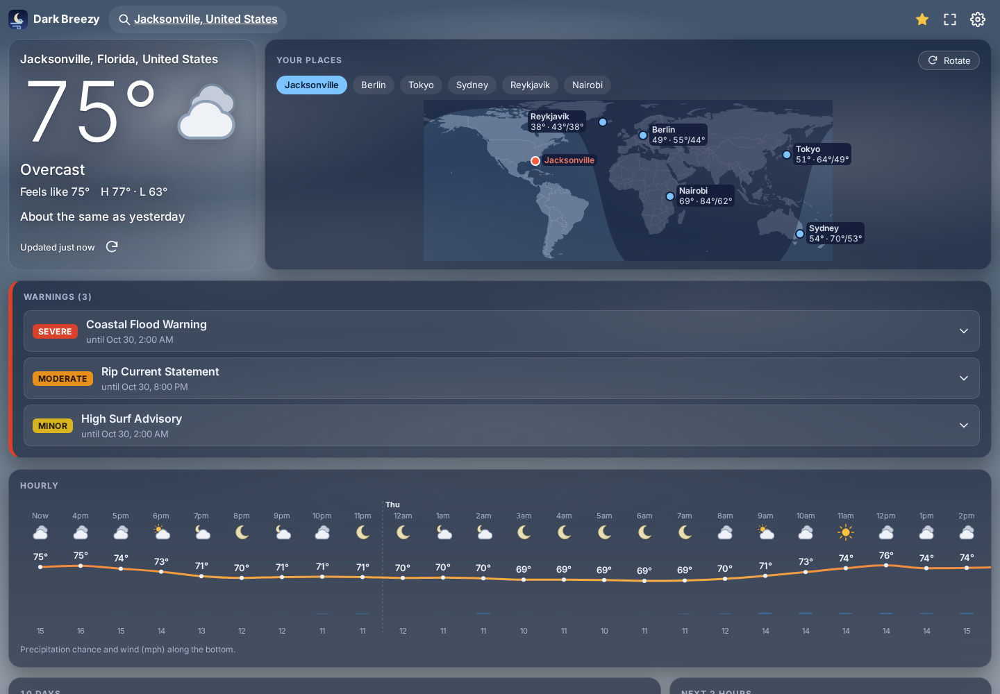
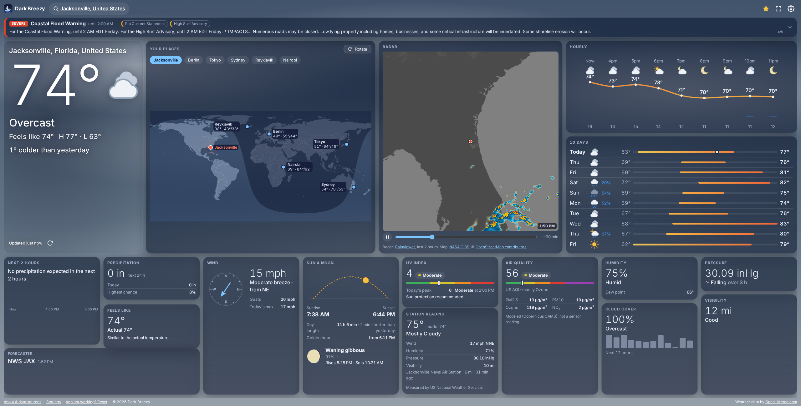
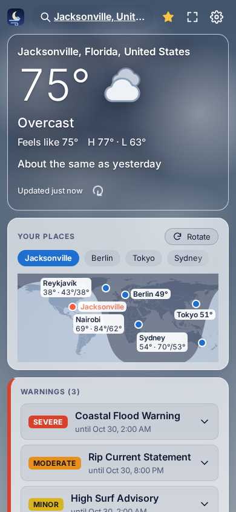

# Dark Breezy

**Weather, without the clutter.** A fast, private weather dashboard for
anywhere in the world: current conditions, the forecast, radar and
official warnings, all on one page.

### 👉 [Try it: darkbreezy.com](https://darkbreezy.com/)

## What you get

- **Everything at a glance.** Temperature, radar, hourly and 10-day forecasts, wind, UV, air quality, pollen, sun and moon, and more.
- **Official warnings.** They come straight from the agencies that issue them (the US, Canada, Germany, Japan and Hong Kong), plus global disaster alerts everywhere else.
- **Your places on a map.** Star the places you care about to see their weather side by side, or let Dark Breezy rotate through them.
- **Made for big screens too.** On a wide monitor or TV, everything fits on one screen. It also works as a desktop wallpaper.
- **Private by design.** No accounts, no ads, no tracking, no cookies. Your places and settings stay in your browser.
- **Free and open.** No server of its own and no API keys: it talks directly to open weather services.

## Tips

- **Swipe** sideways on a phone to move between your places.
- **Layout** (in Settings): *Auto* fits everything on big screens and scrolls on smaller ones. *Scroll* and *Fit* pick one or the other.
- **Wallpaper mode:** Settings › Wallpaper builds an address for wallpaper apps such as Lively or Plash. Press Esc there for a way out.
- **Any setting can go in the address.** For example, `?theme=dark&layout=fit&rotate=1` applies to that page only and is never saved.

Where the data comes from, and its licenses: [docs/data-sources.md](docs/data-sources.md).
The screenshots show live data from those sources: weather by Open-Meteo, warnings by the US National Weather Service, radar by [RainViewer](https://www.rainviewer.com/), and maps by NASA GIBS, © OpenStreetMap contributors and Natural Earth.

 

## Develop

The site in `web/` is plain JavaScript modules: no framework, no build step needed to run it.

    npm install
    npm run serve            # http://localhost:8000
    npm test                 # unit tests
    npx playwright install   # once
    npm run test:e2e         # browser tests (Chromium and Firefox)
    npm run test:e2e:dist    # the same, against a fresh build
    npm run test:ci          # all of it the way CI runs it, in a Linux container (Docker or Podman)

The browser tests answer every weather service from `tests/fixtures`, so they
need no network. Run `npm run test:ci` before pushing: it catches what only shows up
on CI's machine, like text that wraps differently in its fonts. Other handy commands:

- `npm run fixtures`: re-records those answers from the real services.
- `npm run check-sources`: checks every data source still answers a browser.
- `npm run screenshots`: retakes the pictures above, with live weather.
- `npx playwright test layout --update-snapshots`: after an intended visual change.

## Build and deploy

    ./scripts/build.sh -c    # minified site in dist/web

Pushing to the default branch runs every test and deploys to GitHub Pages
(`.github/workflows/site.yml`).

## Where things are

    web/js/api/        data sources (alerts/ has one adapter per agency)
    web/js/state/      settings, favorites, the weather cache
    web/js/widgets/    the dashboard's cards
    web/js/views/      dashboard, search, settings, about
    web/js/util/       units, time zones, sun and moon, places

MIT license.
